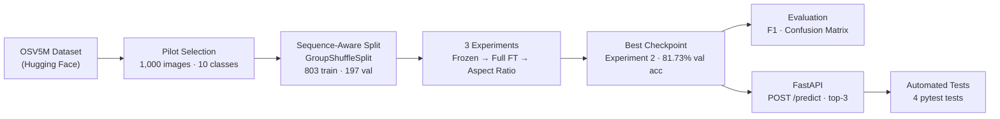
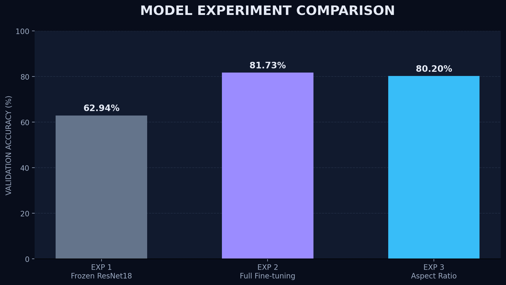
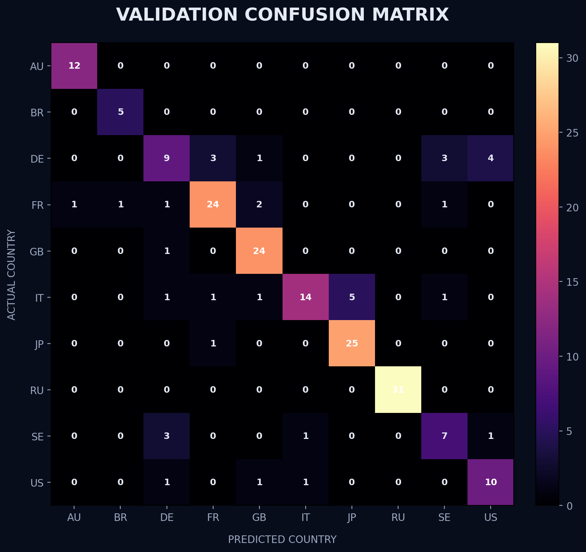
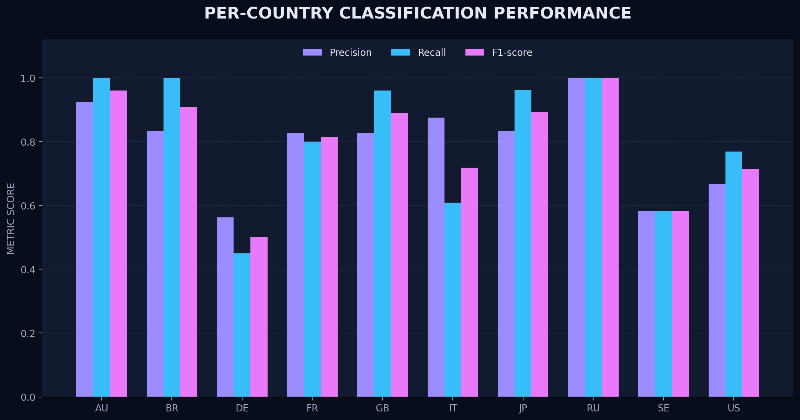
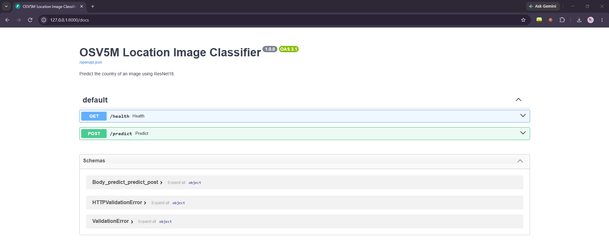
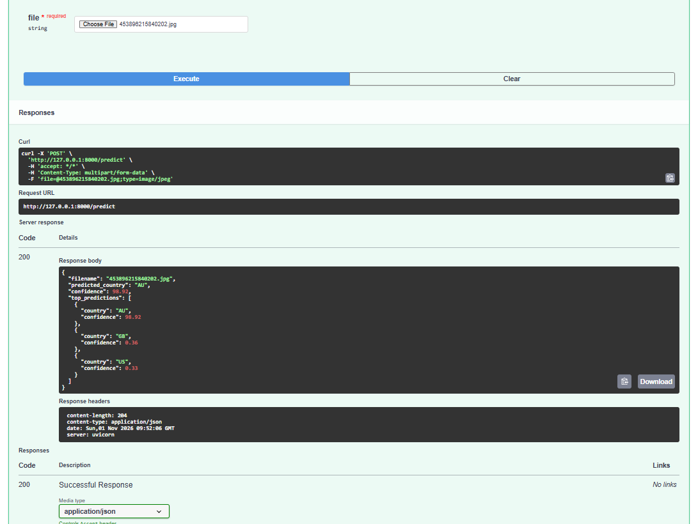

# OSV5M Location Image Classifier

**Country-level geolocation from street-view images — fine-tuned ResNet18 · FastAPI · 81.73% pilot validation accuracy**

[](https://www.python.org/)
[](https://pytorch.org/)
[](https://fastapi.tiangolo.com/)
[](tests/test_api.py)
[](LICENSE)

---

## At a Glance

| Metric | Value |
|---|---|
| Dataset | OSV5M · 1,000-image pilot · 10 countries · 100 images/class |
| Split | GroupShuffleSplit (sequence-aware) · 803 train / 197 val · 0 sequence overlap |
| Architecture | ImageNet-pretrained ResNet18 · 10-class linear head |
| Best pilot val. accuracy | **81.73%** (Experiment 2 — full fine-tuning) |
| Best macro F1 | **0.7980** |
| Best weighted F1 | **0.8107** |
| API | FastAPI · `GET /health` · `POST /predict` (top-3 predictions) |
| Automated tests | 4 passed — health check, valid image, invalid file, corrupted image |

> [!IMPORTANT]
> All metrics are **pilot validation results** on 197 images drawn from the same 1,000-image dataset. No independent test set has been evaluated. Results reflect early-stage feasibility, not production generalization.

---

## Table of Contents

1. [Project Overview](#1-project-overview)
2. [End-to-End Workflow](#2-end-to-end-workflow)
3. [Dataset & Sequence-Aware Split](#3-dataset--sequence-aware-split)
4. [Model Architecture](#4-model-architecture)
5. [Experiments](#5-experiments)
6. [Evaluation Results](#6-evaluation-results)
7. [API Demo](#7-api-demo)
8. [Setup & Installation](#8-setup--installation)
9. [Running the API](#9-running-the-api)
10. [Example API Request & Response](#10-example-api-request--response)
11. [Tests & Verification](#11-tests--verification)
12. [Repository Structure](#12-repository-structure)
13. [Limitations & Future Work](#13-limitations--future-work)
14. [Author](#14-author)

---

## 1. Project Overview

This project builds a country-level geolocator that accepts a street-view photograph and returns the most likely country of origin. A 1,000-image pilot subset was drawn from the [OSV5M dataset](https://huggingface.co/datasets/osv5m/osv5m) — a large-scale, Creative-Commons-licensed collection of geotagged images — covering 10 countries with 100 images each.

Three controlled fine-tuning experiments explore how training strategy and preprocessing affect accuracy on this small dataset. The best checkpoint is served through a minimal FastAPI endpoint with input validation, lazy model loading, and automated API tests.

**Skills demonstrated:** transfer learning, sequence-aware data splitting, experiment design and comparison, per-class evaluation, FastAPI deployment, dependency injection, automated API testing.

---

## 2. End-to-End Workflow



---

## 3. Dataset & Sequence-Aware Split

**Source:** [osv5m/osv5m](https://huggingface.co/datasets/osv5m/osv5m) on Hugging Face · images streamed from 98 remote ZIP shards via `remotezip`.

**Pilot composition:** 1,000 images, balanced at 100 per country.

| Code | Country | Images |
|:----:|---------|-------:|
| AU | Australia | 100 |
| BR | Brazil | 100 |
| DE | Germany | 100 |
| FR | France | 100 |
| GB | United Kingdom | 100 |
| IT | Italy | 100 |
| JP | Japan | 100 |
| RU | Russia | 100 |
| SE | Sweden | 100 |
| US | United States | 100 |

**Why sequence-aware splitting matters**

OSV5M images are organized into *sequences* — consecutive frames from the same street-level capture. A naïve random split would place frames from the same sequence in both train and validation sets, allowing the model to memorize location-specific visual context rather than learn generalizable features. This would produce inflated validation accuracy that does not reflect real-world performance.

`GroupShuffleSplit` (scikit-learn) treats each sequence as an indivisible group, guaranteeing zero sequence overlap between splits:

```python
from sklearn.model_selection import GroupShuffleSplit

splitter = GroupShuffleSplit(n_splits=1, test_size=0.20, random_state=42)
train_idx, val_idx = next(splitter.split(df, groups=df["sequence"]))
```

| Split | Images | Sequence overlap |
|-------|-------:|:----------------:|
| Train | 803 | — |
| Validation | 197 | **0** |

The dataset and checkpoints are excluded from Git (`.gitignore`). Download instructions are in `src/download_pilot_images.py`.

---

## 4. Model Architecture

An **ImageNet-pretrained ResNet18** (torchvision `ResNet18_Weights.DEFAULT`) serves as the backbone. The original 1,000-class ImageNet head is replaced with a single linear layer mapping 512 features to 10 country classes:

```python
model.fc = nn.Linear(model.fc.in_features, num_classes)  # 512 → 10
```

| Component | Detail |
|-----------|--------|
| Backbone | ResNet18 (11.18 M total parameters) |
| Classifier head | `Linear(512, 10)` |
| Pretrained weights | ImageNet (`ResNet18_Weights.DEFAULT`) |
| Loss function | `CrossEntropyLoss` |
| Optimizer | Adam |
| Input size | 224 × 224 · ImageNet normalization |
| Inference config | `experiments/inference_config.json` |

---

## 5. Experiments

Three experiments vary the training strategy and preprocessing while keeping all other hyperparameters fixed.

| # | Experiment | Backbone | Preprocessing | LR | Epochs | Best Val Acc |
|---|-----------|----------|--------------|----:|------:|------------:|
| 1 | Frozen ResNet18 | Frozen (fc only) | Fixed resize 224 px | 1e-3 | 6 | 62.94% |
| 2 | Full fine-tuning | All layers trainable | Fixed resize 224 px | 1e-4 | 5 | **81.73%** |
| 3 | Aspect-ratio preprocessing | All layers trainable | Resize 256 → crop 224 | 1e-4 | 5 | 80.20% |

**Experiment 1 → 2:** Unfreezing all layers and lowering the learning rate from 1e-3 to 1e-4 gained **+18.79 pp** — confirming that ImageNet features alone are insufficient and that domain adaptation through full fine-tuning is necessary for geolocation.

**Experiment 2 → 3:** Switching to aspect-ratio-aware preprocessing (resize to 256, then crop to 224) slightly reduced accuracy to 80.20%, suggesting that the simpler fixed resize performs adequately at this pilot scale.

**Best checkpoint:** `checkpoints/experiment2_full_finetuning_best.pth` (Epoch 5).

### Training curves — Experiment 2

| Epoch | Train Loss | Train Acc | Val Loss | Val Acc |
|------:|-----------:|----------:|---------:|--------:|
| 1 | 1.2880 | 60.65% | 0.9132 | 73.60% |
| 2 | 0.4305 | 89.66% | 0.7422 | 79.19% |
| 3 | 0.1953 | 96.64% | 0.7822 | 78.17% |
| 4 | 0.1319 | 97.26% | 0.6832 | 80.20% |
| 5 | 0.0842 | 98.88% | 0.7241 | **81.73%** |

The growing gap between training and validation loss from epoch 3 onward is consistent with overfitting on a small pilot — a known limitation addressed in [§13](#13-limitations--future-work).

### Experiment comparison chart



*Best validation accuracy per experiment. Experiment 2 (full fine-tuning) achieves 81.73%, outperforming the frozen backbone (Exp 1) by 18.79 pp.*

---

## 6. Evaluation Results

All metrics below are from Experiment 2's best checkpoint evaluated on the 197-image validation set.

> [!NOTE]
> These are **validation** metrics, not test-set metrics. The pilot contains no held-out test set. Confidence scores are softmax outputs and are not calibrated.

### Summary

| Metric | Value |
|--------|------:|
| Validation accuracy | 81.73% |
| Macro F1 | 0.7980 |
| Weighted F1 | 0.8107 |
| Macro precision | 0.7932 |
| Macro recall | 0.8133 |

### Per-class breakdown

| Country | Precision | Recall | F1 | Support |
|---------|----------:|-------:|---:|--------:|
| AU | 0.923 | 1.000 | 0.960 | 12 |
| BR | 0.833 | 1.000 | 0.909 | 5 |
| DE | 0.563 | 0.450 | 0.500 | 20 |
| FR | 0.828 | 0.800 | 0.814 | 30 |
| GB | 0.828 | 0.960 | 0.889 | 25 |
| IT | 0.875 | 0.609 | 0.718 | 23 |
| JP | 0.833 | 0.962 | 0.893 | 26 |
| RU | 1.000 | 1.000 | 1.000 | 31 |
| SE | 0.583 | 0.583 | 0.583 | 12 |
| US | 0.667 | 0.769 | 0.714 | 13 |
| **macro avg** | **0.793** | **0.813** | **0.798** | 197 |
| **weighted avg** | **0.815** | **0.817** | **0.811** | 197 |

**Strong performers:** RU (F1 1.00), AU (0.96), GB (0.89), JP (0.89). These countries likely have distinctive visual signatures in the pilot.

**Weaker performers:** DE (F1 0.50), SE (0.58). Germany and Sweden share similar Northern European visual cues; confusion between them is visible in the matrix below.

### Confusion matrix



*Rows = actual country · Columns = predicted country. RU and AU are classified perfectly. DE and SE show mutual confusion, consistent with similar European visual environments.*

### Classification metrics chart



*Per-class precision, recall, and F1-score. Russia achieves perfect scores; Germany and Sweden are the weakest classes.*

---

## 7. API Demo

The FastAPI application loads the Experiment 2 checkpoint on first request (lazy initialization) and exposes two endpoints.

### Swagger UI



*Auto-generated interactive documentation at `http://127.0.0.1:8000/docs`. The `/predict` endpoint accepts a multipart image upload.*

### Selecting an input image


*Swagger's "Choose File" dialog lets you select any local image for a live prediction test.*

### Example input image


*A representative street-view image used to test the live API endpoint.*

### Prediction response



*The `/predict` response returns the top predicted country, its softmax confidence score (%), and the full top-3 ranking.*

---

## 8. Setup & Installation

**Requirements:** Python 3.12 · CUDA optional (CPU inference is fully supported).

```bash
# Clone the repository
git clone https://github.com/ShraddhaParmar09/location-image-classifier-mlops.git
cd location-image-classifier-mlops
```

**Windows PowerShell**
```powershell
python -m venv .venv
.\.venv\Scripts\Activate.ps1
python -m pip install -r requirements.txt
```

**macOS / Linux**
```bash
python3 -m venv .venv
source .venv/bin/activate
pip install -r requirements.txt
```

> [!TIP]
> `requirements.txt` pins `torch==2.14.1` and `torchvision==0.29.1` (CUDA 13.0 builds used locally). For CPU-only or a different CUDA version, install PyTorch separately from [pytorch.org](https://pytorch.org/get-started/locally/) before running `pip install -r requirements.txt`.

The dataset and model checkpoints are excluded from Git. To download the pilot images, run:

```bash
python src/download_pilot_images.py
```

---

## 9. Running the API

```bash
python -m uvicorn src.api:app --host 127.0.0.1 --port 8000
```

| Endpoint | Method | Description |
|----------|--------|-------------|
| `/health` | `GET` | Returns model name, status, and device |
| `/predict` | `POST` | Accepts a multipart image upload; returns top-3 country predictions |
| `/docs` | `GET` | Auto-generated Swagger UI |
| `/redoc` | `GET` | ReDoc API reference |

The model loads from `checkpoints/experiment2_full_finetuning_best.pth` on the first request. Subsequent requests reuse the cached instance.

---

## 10. Example API Request & Response

**Health check**

```bash
curl http://127.0.0.1:8000/health
```

```json
{
  "status": "healthy",
  "model": "OSV5M ResNet18",
  "device": "cuda"
}
```

**Predict country from image**

```bash
curl -X POST http://127.0.0.1:8000/predict \
  -F "file=@/path/to/your/image.jpg"
```

```json
{
  "filename": "image.jpg",
  "predicted_country": "JP",
  "confidence": 87.34,
  "top_predictions": [
    { "country": "JP", "confidence": 87.34 },
    { "country": "GB", "confidence": 5.21 },
    { "country": "FR", "confidence": 3.85 }
  ]
}
```

The `confidence` field is a softmax probability scaled to a percentage. It is **not** a calibrated probability — high confidence does not guarantee correctness, especially on out-of-distribution images.

**Error responses**

| Scenario | Status | Detail |
|----------|--------|--------|
| Non-image MIME type | 400 | `"Please upload a valid image file."` |
| Corrupted image bytes | 400 | `"Invalid or corrupted image."` |
| Empty upload | 400 | `"Uploaded image is empty."` |

---

## 11. Tests & Verification

```bash
python -m pytest tests/test_api.py -v
```

The test suite uses FastAPI's dependency injection to override `get_predictor()` with a `MockPredictor` (deterministic mock model + CPU device), eliminating the checkpoint requirement. All 4 tests pass without loading the real model.

| Test | What it verifies |
|------|-----------------|
| `test_health` | `GET /health` returns `200`, correct model name, and `"cpu"` device |
| `test_predict_valid_image` | `POST /predict` with a synthetic 100×100 JPEG returns `200`, a valid country code, confidence in `[0, 100]`, and exactly 3 top predictions |
| `test_predict_invalid_file` | Uploading `text/plain` returns `400` with the correct error message |
| `test_predict_corrupted_image` | Uploading `image/jpeg` with non-JPEG bytes returns `400` with the correct error message |

Real model inference (loading the Experiment 2 checkpoint and running predictions) was verified separately.

---

## 12. Repository Structure

```
location-image-classifier-mlops/
├── configs/
│   ├── experiment1.json          # Frozen backbone config
│   ├── experiment2.json          # Full fine-tuning config (best)
│   └── experiment3.json          # Aspect-ratio preprocessing config
├── data/
│   ├── images/                   # Downloaded images (gitignored)
│   │   └── {AU,BR,DE,...}/
│   └── metadata/
│       ├── pilot_selection.csv   # 1,000-image selection from OSV5M
│       ├── train_split.csv       # 803 training images
│       └── validation_split.csv  # 197 validation images
├── checkpoints/                  # Saved model weights (gitignored)
├── experiments/
│   ├── experiment1_frozen_resnet18_metrics.csv
│   ├── experiment2_full_finetuning_metrics.csv
│   ├── experiment3_aspect_ratio_metrics.csv
│   └── inference_config.json     # Active inference configuration
├── reports/
│   ├── experiment-comparison.png
│   ├── confusion-matrix.png
│   ├── classification-metrics.png
│   ├── classification_report.csv
│   ├── confusion_matrix.csv
│   ├── experiment_comparison.csv
│   ├── api-swagger-demo.png
│   ├── api-prediction-demo.png
│   └── image which we uploaded.jpg
├── src/
│   ├── api.py                    # FastAPI application
│   ├── dataset.py                # OSV5MDataset + class definitions
│   ├── download_pilot_images.py  # Image download from HF shards
│   ├── evaluate_model.py         # Classification report + confusion matrix
│   ├── inference.py              # LocationImagePredictor + CLI
│   ├── model.py                  # build_resnet18()
│   ├── preprocessing.py          # get_transforms() — fixed & aspect-ratio
│   ├── run_experiment.py         # Experiment runner (config-driven)
│   └── train.py                  # Training loop + evaluation
├── tests/
│   └── test_api.py               # 4 pytest API tests
├── requirements.txt
└── README.md
```

---

## 13. Limitations & Future Work

**Current limitations**

- **Pilot scale.** 1,000 images (100/class) is small. The model likely overfits — training accuracy reaches ~98.9% while validation accuracy plateaus at ~81.7% (Experiment 2, epoch 5). Results should be treated as a feasibility signal, not a benchmark.
- **No independent test set.** All reported metrics use the same 197 validation images that informed checkpoint selection. An independent held-out test set is needed to assess true generalization.
- **10-class coverage only.** OSV5M covers 238 countries; this pilot classifies only 10.
- **Uncalibrated confidence scores.** Softmax outputs are not temperature-scaled or otherwise calibrated. High confidence values may be misleading.
- **No learning rate scheduling.** All experiments use a constant Adam learning rate.

**Planned improvements**

- Scale to a larger OSV5M subset and expand country coverage.
- Introduce a proper held-out test set (separate from the validation split used during training).
- Add a learning rate scheduler (e.g., cosine annealing or `ReduceLROnPlateau`).
- Apply confidence calibration (temperature scaling).
- Integrate experiment tracking (MLflow or Weights & Biases).
- Explore stronger backbone architectures (ResNet50, EfficientNet, ViT).
- Add Dockerfile and deploy the API to a cloud container service.

---

## 14. Author

**Shraddha Parmar** — AI/ML Engineer

AI/ML Engineering · Computer Vision · Deep Learning · MLOps

[](https://github.com/ShraddhaParmar09)
[](https://github.com/ShraddhaParmar09/location-image-classifier-mlops)

---

<sub>Dataset: <a href="https://huggingface.co/datasets/osv5m/osv5m">OSV5M on Hugging Face</a> · License: MIT · Built with PyTorch, FastAPI, scikit-learn</sub>
